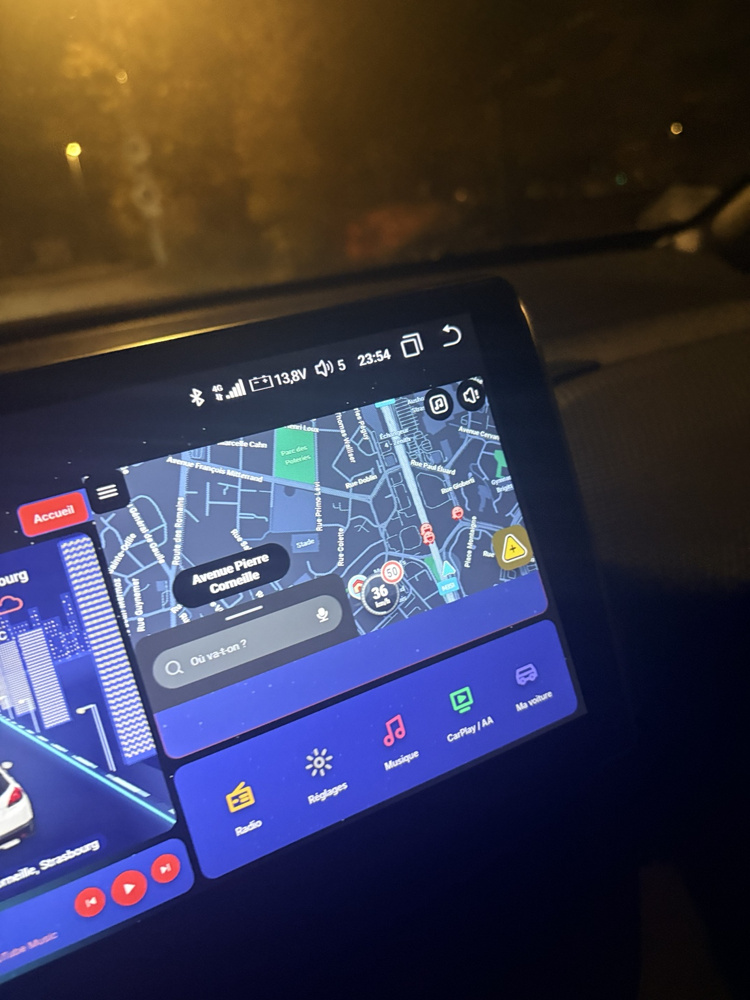
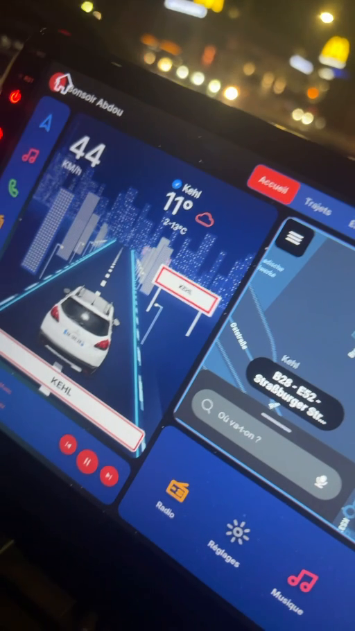
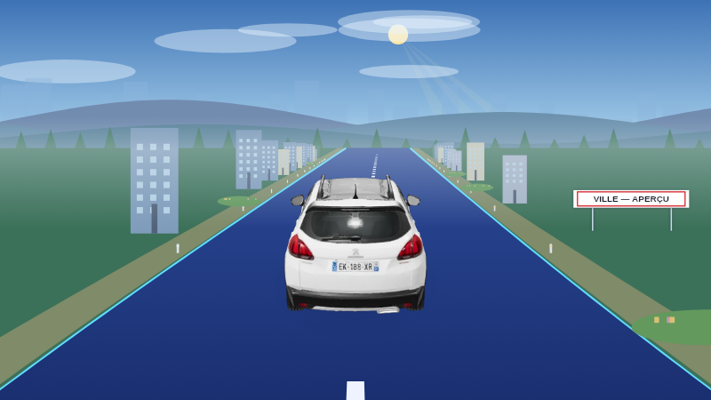
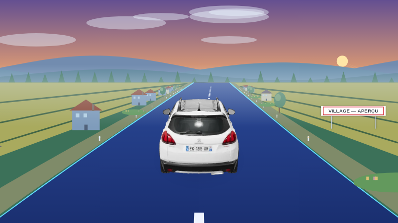
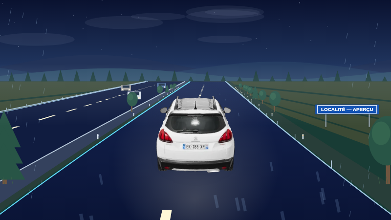

# Accueil 2008 GT

**Lanceur Android personnel · Version 7.22 · Peugeot 2008 GT Line**

[Télécharger l’APK 7.22](https://github.com/Roudousa-67/accueil2008/releases/download/v7.22/Accueil2008GT_v7.22.apk) · [Notes de version](https://github.com/Roudousa-67/accueil2008/releases/tag/v7.21)

Accueil 2008 GT est un lanceur Android personnalisé développé pour le projet Peugeot 2008 GT Line. Il réunit l’accès au GPS, la musique, un décor de route animé, les informations disponibles du véhicule et les réglages sur un même écran.

L’application est un projet personnel. Ce n’est pas une application officielle Peugeot, Waze ou Google.

**Version présentée : 7.21.** Les photos d’utilisation proviennent des images et de la vidéo envoyées avant cette version. Les illustrations du décor 7.21 ci-dessous sont des rendus du code et du sprite d’origine, avec des options de démonstration activées. Ce ne sont pas des captures Android de l’autoradio, ni des images générées par IA.

## Mise à jour 7.22 — adresse au bas de la route

Adresse, code postal et ville sur une ligne discrète au bord inférieur de la route, sans encadré. Le décor et les fonctions existantes restent conservés. Actualisation selon le délai choisi dans Navigation → Panneaux et localités. 370 contrôles automatisés réussis ; essai sur autoradio à effectuer.


## 1. Installation et équipement



*photo de l’installation réelle. Le lanceur affiche le décor et les raccourcis, tandis que Waze occupe une zone à côté. Cette photo montre une version antérieure à la 7.21 ; elle ne prouve pas le fonctionnement des nouvelles options sur le poste.*

### Équipement et informations disponibles

| Élément | Information à publier |
| --- | --- |
| Véhicule du projet | Peugeot 2008 GT Line — désignation utilisée pour ce projet. |
| Année et motorisation | À confirmer. Le modèle 3D intitulé « 2018 Peugeot 2008 » ne permet pas de déduire l’année du véhicule réel. |
| Autoradio | Poste Android avec écran tactile, visible sur les photos. Marque et référence à confirmer. |
| Version Android installée | À confirmer. Le minimum Android 7.0 indiqué pour l’APK est une exigence logicielle, pas une identification du système du poste. |
| Écran | Dimensions, diagonale et résolution matérielle à confirmer. |
| Processeur, RAM, stockage | À confirmer ; aucune caractéristique déduite d’une photo. |
| GPS utilisé sur les images | Waze est visible. Les autres applications effectivement installées restent à préciser. |
| Connexion Internet | Une icône 4G apparaît sur la photo. SIM intégrée ou connexion via téléphone : à confirmer. |
| Boîtier CAN | Référence, protocole et signaux réellement transmis à confirmer. La présence d’un lecteur dans le code ne prouve pas que toutes les données arrivent sur ce véhicule. |
| Micro et commandes au volant | Matériel et fonctionnement à confirmer sur le poste. |

Le lanceur peut utiliser les informations GPS et les signaux du véhicule lorsqu’ils sont disponibles. Une valeur manquante ne doit pas être décrite comme une mesure réellement obtenue. Les fonctions liées au boîtier dépendent de l’installation et de la configuration du poste.

## 2. Accueil et raccourcis



*extrait de la vidéo d’utilisation. Il montre le décor automobile, les indications affichées, la zone GPS et les raccourcis. Les panneaux visibles correspondent à l’ancienne version filmée ; ils ne sont pas une illustration des corrections 7.21.*

L’accueil donne accès aux fonctions du poste et aux applications choisies. La disposition personnalisable permet de placer et redimensionner les widgets. Des éléments peuvent être regroupés et organisés sur plusieurs pages.

La barre d’applications peut être compacte pour laisser davantage de place au GPS. Dans la disposition Autoradio standard, la modification redistribue une rangée entre le GPS et la barre. Une disposition personnelle reste réglable manuellement : toutes les grilles ne permettent pas le même agrandissement automatique.

**Où régler :** Paramètres → Écran d’accueil → Barre d’applications. La hauteur de la barre Accueil possède aussi son réglage dédié.

## 3. GPS et géolocalisation

Le cadre GPS permet de choisir une application Android installée, par exemple Waze ou Google Maps. Le réglage du cadre et son positionnement appartiennent au lanceur ; la carte, les recherches et le guidage appartiennent à l’application GPS choisie.

**Où régler :** Paramètres → Navigation → Cadre GPS.

L’ouverture intégrée dépend du firmware, de la version Android et des permissions du poste. La présence du cadre dans le lanceur ne garantit pas que toutes les applications GPS pourront y être intégrées sur tous les autoradios. Le plein écran reste une possibilité lorsque le cadre n’est pas pris en charge.

Les photos montrent Waze sur une installation particulière. Elles ne constituent pas un test de compatibilité universel. Le masquage des barres Android dépend lui aussi du système du poste.

## 4. Panneaux de ville, village et autoroute

Le nom du panneau est obtenu à partir de la position GPS et des données cartographiques disponibles. En ville ou dans un village, l’application recherche la localité correspondante. Sur autoroute, elle peut afficher une localité proche ; il ne s’agit pas nécessairement de la prochaine sortie ni d’une ville située devant le véhicule.

Le panneau fait partie du décor animé. Il grandit avec la perspective et passe sur le côté. Les protections évitent de le faire traverser la voiture. Aucun second panneau permanent n’est ajouté sous la voiture ou en bas à gauche.

**Où régler :** Paramètres → Navigation → Panneaux et localités : actualisation, taille, distance au bord de la route et fréquence de passage.

L’actualisation des noms est distincte de l’animation : le décor peut défiler à chaque image, tandis que le nom est recherché selon le délai réglé. Une position GPS récente et une connexion Internet sont nécessaires aux recherches de localités. Sans données récentes, un ancien nom ne doit pas être présenté comme une localisation fiable.

## 5. Décor 7.21 : exemples issus du code



*exemple du décor « Ville », calculé par le moteur Canvas 7.21 et affiché avec le sprite de voiture d’origine. Les options sont activées pour la démonstration. « VILLE — APERÇU » n’est pas une localisation réelle. Ce rendu isolé ne montre pas l’interface complète ni Waze.*



*exemple du décor « Village » à une heure de démonstration, avec maisons, végétation et panneau sur le côté. Les bâtiments et le paysage sont décoratifs ; ils ne reproduisent pas les lieux traversés.*



*exemple du décor « Autoroute », de nuit et sous une pluie de démonstration. Les véhicules opposés sont représentés sur la chaussée séparée. Le trafic dessiné n’est pas une détection des véhicules réels.*

Les 39 options choisies, D04 et D13 à D50, sont rangées dans cinq rubriques. Chaque option possède son interrupteur. Elles sont désactivées au départ pour conserver le décor précédent jusqu’au choix de l’utilisateur. Les protections des panneaux restent conservées.

### Navigation → Décor · Voiture

| Option | Effet et réglage |
| --- | --- |
| D04 — Roues en rotation | Active la rotation liée à la vitesse disponible. Sur le sprite arrière, seuls de petits détails de bande de roulement sont visibles ; les jantes ne sont pas inventées derrière la carrosserie. |

### Navigation → Décor · Route

| Option | Effet et réglage |
| --- | --- |
| D13 — Accotements naturels | Ajoute une bordure végétale entre la chaussée et les éléments du décor. |
| D14 — Virages doux | Courbe légèrement la route dessinée. C’est un effet décoratif, pas une reproduction des virages du GPS. |
| D15 — Relief à l’horizon | Ajoute de légères ondulations visuelles. Ne mesure pas la pente réelle. |
| D16 — Glissières détaillées | Détaille les rails et les poteaux sur les côtés de l’autoroute. |
| D17 — Balises réfléchissantes | Ajoute de petits réflecteurs au bord de la chaussée dessinée. |
| D18 — Marquages de nuit | Renforce doucement l’éclairage des marquages quand le décor est nocturne. |
| D19 — Route humide | Affiche des reflets atténués lorsque la météo reçue indique pluie ou orage. |
| D20 — Passages sous les ponts | Ajoute des ponts décoratifs et un passage progressif dans l’ombre. Ne détecte pas les ponts réels. |

### Navigation → Décor · Paysages

| Option | Effet et réglage |
| --- | --- |
| D21 — Arbres plus variés | Alterne les formes de feuillus et de conifères. |
| D22 — Végétation en profondeur | Superpose plusieurs plans de végétation et de petits détails proches. |
| D23 — Densité du décor | Permet de choisir peu, moyen ou beaucoup de végétation lorsque l’option est activée. |
| D24 — Maisons de village | Varie les façades, les toits et les détails des maisons dessinées. |
| D25 — Ville plus vivante | Varie les hauteurs et couleurs des immeubles. |
| D26 — Fenêtres allumées | Éclaire quelques fenêtres pendant la nuit. |
| D27 — Places et jardins | Insère de petits espaces aménagés entre les éléments du décor. |
| D28 — Campagne | Ajoute des champs et des haies en arrière-plan. |
| D29 — Montagnes | Ajoute des silhouettes lointaines sur plusieurs plans. |
| D30 — Saisons | Choisit une saison manuelle ou suit le calendrier du poste. La saison reste un effet visuel. |

### Navigation → Décor · Ciel et météo

| Option | Effet et réglage |
| --- | --- |
| D31 — Nuages en plusieurs plans | Superpose des nuages dont les mouvements sont lents et différents. |
| D32 — Aube rosée | Ajoute des teintes rosées aux heures du matin. |
| D33 — Coucher de soleil | Donne des couleurs chaudes au décor en fin de journée. |
| D34 — Nuit étoilée | Ajoute des étoiles discrètes, sans clignotement. |
| D35 — Halo de lune | Dessine une lueur fine autour de la lune visible. |
| D36 — Rayons de soleil | Ajoute des rayons discrets lorsque le soleil est présent. |
| D37 — Brume lointaine | Applique un voile près de l’horizon en conservant la lisibilité des panneaux. |
| D38 — Pluie latérale | Ajoute des particules latérales lorsque la météo indique pluie ou orage. |
| D39 — Neige légère | Affiche des flocons latéraux lorsque la météo indique neige. |
| D40 — Vent dans la végétation | Applique un faible balancement aux feuillages. |

Le soleil, la lune et le ciel progressif disposent aussi des réglages existants dans Navigation → Décor de la route. Les astres utilisent l’heure et, si disponible, un GPS récent ; sinon, un rythme indicatif est utilisé. Leur projection ne suit pas le cap réel du véhicule.

### Navigation → Décor · Animation et panneaux

| Option | Effet et réglage |
| --- | --- |
| D41 — Défilement en profondeur | Différencie les déplacements des plans proches et lointains. |
| D42 — Apparition progressive | Fait apparaître progressivement les objets éloignés. |
| D43 — Sortie fluide | Prolonge le défilement pour que les objets sortent par les côtés. |
| D44 — Panneaux près de la route | Rapproche le panneau de l’accotement en gardant une marge autour de la voiture. |
| D45 — Petit espace pour le panneau | Réduit l’espace réservé entre le panneau et les bâtiments. |
| D46 — Panneaux dégagés | Renforce le rendu du panneau et conserve le texte et les poteaux devant le décor. |
| D47 — Passage naturel du panneau | Rend son déplacement dans la perspective plus continu. |
| D48 — Circulation inverse détaillée | Détaille les véhicules dessinés sur la chaussée opposée de l’autoroute. |
| D49 — Transitions progressives | Active une transition renforcée entre les paysages, en s’appuyant sur le réglage de fondu existant. |
| D50 — Niveaux d’animation | Permet de comparer calme, normal et riche en aperçu, puis d’appliquer le niveau choisi. Ne modifie pas automatiquement les autres interrupteurs. |

L’aperçu local permet de comparer ville, village, campagne, forêt et autoroute, ainsi que plusieurs heures et météos. Il utilise des données de démonstration et ne change ni le GPS réel ni les données du véhicule.

## 6. Paramètres, recherche et personnalisation

La recherche est placée en haut des paramètres. Elle cherche dans les noms des rubriques et dans leur contenu. Un filtre réduit les résultats à une catégorie. La dictée est proposée lorsque le poste dispose d’un service vocal utilisable ; le clavier reste disponible sinon.

Le défilement est conservé quand un changement de réglage recrée l’interface, afin d’éviter de revenir au début de la page après chaque appui.

Les réglages existants comprennent notamment la disposition de l’accueil, les widgets, les raccourcis, les thèmes, les profils, le cadre GPS et les fonctions liées au véhicule. Une possibilité présente dans le code ne signifie pas que le matériel correspondant est installé sur chaque autoradio.

**Images à compléter :** captures Android des pages Recherche, Décor, Téléchargement et Stockage de la 7.21. Aucun faux écran de ces pages n’est utilisé dans cette proposition.

## 7. Informations du véhicule, trajets et entretien

Les informations du véhicule sont affichées lorsqu’elles sont reçues et exploitables. Selon le poste et le boîtier, cela peut concerner la vitesse, le carburant, l’autonomie ou certains états. L’apprentissage et le diagnostic aident à identifier ce qui arrive réellement ; ils ne créent pas les capteurs manquants.

Les fonctions de trajets existantes permettent de consulter des informations et un historique, ainsi que des parcours GPS lorsque leur enregistrement est activé. Les distances et statistiques dépendent des données disponibles.

Les données d’entretien, les échéances, les pleins et les historiques doivent être interprétés selon leur source : saisie de l’utilisateur, calcul de l’application ou information reçue. Les échéances génériques ne remplacent pas le carnet adapté au véhicule réel.

Les traces GPS de parcours ne sont pas incluses dans la sauvegarde des réglages. Il ne faut pas annoncer une sauvegarde complète des trajets en parlant de la seule sauvegarde de configuration.

## 8. Mises à jour et téléchargement — N35

**Où régler :** Paramètres → Mises à jour → Téléchargement et vérification.

1. L’application vérifie si une nouvelle version est annoncée sur GitHub.
2. Une proposition permet de reporter ou de demander le téléchargement.
3. Après validation, les réglages sont sauvegardés et le téléchargement est lancé.
4. Android fournit la progression réelle. Le téléchargement peut être annulé.
5. Le fichier est contrôlé : empreinte SHA-256, nom du paquet, version et certificat de signature.
6. Une fois le fichier prêt, l’utilisateur ouvre l’installation et la valide dans Android.

Une autorisation Android d’installation depuis cette application peut être demandée. L’application n’installe pas silencieusement une nouvelle version.

Quand la vérification automatique est activée, elle s’effectue après le démarrage puis toutes les six heures pendant que l’application fonctionne. Une connexion Internet est nécessaire. Il ne s’agit pas d’un contrôle permanent lorsque le poste est éteint.

La version est annoncée aux appareils seulement après publication de l’APK. La 7.21 est disponible dans les Releases du dépôt.

## 9. Gestion des fichiers — N46

**Où régler :** Paramètres → Mises à jour → Stockage et nettoyage.

L’utilisateur actualise les tailles, choisit une catégorie, consulte l’aperçu puis confirme le nettoyage. Les catégories concernent le cache de cette application, son emplacement de miniatures en cache et les anciens APK qu’elle a téléchargés. Une catégorie peut être vide.

Le nettoyage conserve les réglages, les trajets, les photos personnelles, les fichiers des autres applications et le téléchargement actuel protégé. Il ne sert pas à nettoyer Waze, Google Maps ou tout le stockage Android.

## 10. Installer la version 7.21

- Télécharger **Accueil2008GT_v7.21.apk** depuis la release officielle du dépôt.
- Sauvegarder les réglages depuis l’application.
- Ouvrir l’APK sur l’autoradio et suivre les demandes Android.
- Installer par-dessus la version précédente, sans désinstaller, pour conserver les données de l’application.
- Activer ensuite les effets souhaités dans Paramètres → Navigation.

APK : [release 7.21](https://github.com/Roudousa-67/accueil2008/releases/tag/v7.21).
Dépôt à utiliser pour la vérification des mises à jour : `Roudousa-67/accueil2008`.

## 11. Vérifications et limites

La 7.21 a passé 361 contrôles automatisés : 113 régressions existantes, 226 contrôles pour les nouvelles fonctions et 22 tests natifs de politique de fichiers. La signature est identique à celle de la 7.20 et les fichiers embarqués ont été comparés aux sources.

Ces contrôles ne constituent pas un essai physique sur l’autoradio. Les performances, l’intégration GPS, le micro, les signaux CAN, le téléchargement Android et l’installation restent à confirmer sur le poste réel. Les retours de son utilisateur permettront de corriger les problèmes observés.

## 12. Crédits

Modèle « 2018 Peugeot 2008 » : tonielpro520 sur Sketchfab, licence CC BY 4.0, conformément aux crédits embarqués. SunCalc 1.9.0 : Vladimir Agafonkin, licence BSD. Les bibliothèques, les polices et les données utilisées conservent leurs licences respectives.

Les photos et la vidéo sont fournies par l’utilisateur. Les images d’utilisation montrent une version antérieure à la 7.21 ; les rendus de démonstration 7.21 sont identifiés dans leurs légendes.

## Sources et développement

- `sources_assets/` : interface, décor et bibliothèques embarquées.
- `module_GPS_java/` : intégration GPS, dictée et gestion des fichiers Android.
- `outils/` : reconstruction à partir d’un APK de base et module DEX fourni. Ce dépôt n’est pas un projet Gradle complet de l’application Android d’origine.
- `tests/` : contrôles automatisés, résultats et bilan de vérification.
- `distribution/` : APK signé, empreinte SHA-256 et notes de version.
- `docs/images/` : photographies et rendus présentés dans ce document.

Avec Node.js 24 et un JDK :

```sh
npm install --prefix tests
npm test --prefix tests
```

[Résultats des contrôles](tests/RESULTATS.txt) · [Bilan de vérification](tests/VERIFICATION.json) · [Publication des versions](GITHUB.md).

La clé privée et son mot de passe ne sont pas publiés dans ce dépôt. Les bibliothèques et ressources conservent leurs licences respectives ; aucune nouvelle licence globale n’est attribuée aux sources du lanceur.

