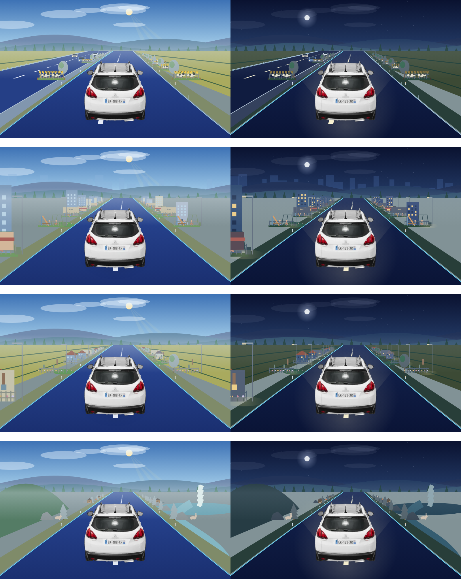

# Décors illustratifs du widget voiture

Branche proposée : `feat/widget-decors-illustres`. Aucun changement de version publiée ni de `version.json`.

27 interrupteurs supplémentaires D51–D77, désactivés par défaut, complètent les options existantes D16 (glissières), D24 (maisons), D26 (fenêtres) et D29 (montagnes). Tous disposent d’une description et du bouton d’information existant.

- Navigation → Décor · Paysages : champs de tournesols, blé, terre, prairies et vaches ; parcs clôturés, enfants animés, toboggans, balançoires, écoles grillagées, commerces et mobilier ; mairie, jardins fleuris et détails des maisons ; rochers, relief, lac, rivière, cascade, cabanes et animaux.
- Décor · Route : portiques sans indications routières et lampadaires hauts.
- Décor · Voiture : faisceaux diffus devant la voiture la nuit.
- Décor · Ciel et météo : reflets discrets des yeux des animaux activés.
- Décor · Animation et panneaux : limitations espacées, ancien nom barré.

Les éléments sont des illustrations locales, jamais des informations sur les lieux réels. La voiture d’origine, le GPS et l’adresse restent conservés. Les réglages sont persistés et restent protégés en conduite.

Les noms sont répartis en lignes puis mesurés pour tenir dans le panneau. Une limitation n’est dessinée que si une route cartographiée correspond à une position GPS récente, avec un `maxspeed` numérique récent ; aucune valeur par défaut ou de simulation n’est affichée. Son panneau occupe un créneau distinct de celui de localité. Le nom précédent barré apparaît pendant 12 secondes après un changement de localité géocodée, avec GPS récent : cela ne prétend pas détecter la position exacte d’un panneau de sortie réel. En aperçu, aucun faux panneau de limitation ni faux changement de localité n’est généré.

Cette planche est produite par le moteur Canvas et composée avec le sprite d’origine en vue arrière, comme dans le widget. Elle n’est pas une capture d’autoradio et ne montre pas le GPS ni l’adresse. Les options sont activées pour présenter les effets.

## Vérification

Commande : `ECJ_JAR="$PWD/work/ecj.jar" npm test --prefix tests` (Node 24, compilateur Eclipse ECJ 3.39.0 pour les tests Java, alternative déjà prévue par les tests).

542 contrôles : 113 régressions, 307 décor/gestion de fichiers, 22 natifs Java, 9 adresse, 52 fonctions 7.23 et 39 nouveaux contrôles du widget. Les nouveaux contrôles couvrent les huit rendus jour/nuit, l’effet visible de chaque nouvelle couche, les limitations absentes/récentes/périmées, les noms longs et le suivi des noms géocodés. L’audit parcourt 53 pages et 215 lignes de paramètres. Les images jour/nuit ont été examinées visuellement. Aucun test physique sur autoradio n’a été effectué.

L’empreinte de l’APK 7.23 existant et ses métadonnées restent valides. Cet APK ne contient pas les nouvelles modifications.

## APK et publication

APK signé bloqué : aucune clé de signature d’origine (`.jks`, `.keystore`, `.p12`) disponible dans l’espace de travail ni aucun secret de signature configuré dans l’environnement. Les outils Android de signature/alignement ne sont pas installés. Aucun APK modifié n’est présenté comme signé ou installable en remplacement de la version existante.

Aucune release, annonce de mise à jour, fusion sur main ou exécution du workflow de publication n’est effectuée. La proposition reste sur sa branche jusqu’à validation.

## Blocage de l’envoi GitHub

Le push HTTPS et la création de branche par le connecteur GitHub ont tous deux été refusés avec HTTP 403 (`Resource not accessible by integration` pour le connecteur). Les permissions annoncées par les métadonnées du dépôt ne suffisent donc pas à écrire avec les connexions actuelles. Le commit reste conservé localement sur la branche de travail ; réautoriser l’intégration GitHub pour ce dépôt avant de reprendre l’envoi. Aucune branche distante ni demande de fusion n’a pu être créée.
